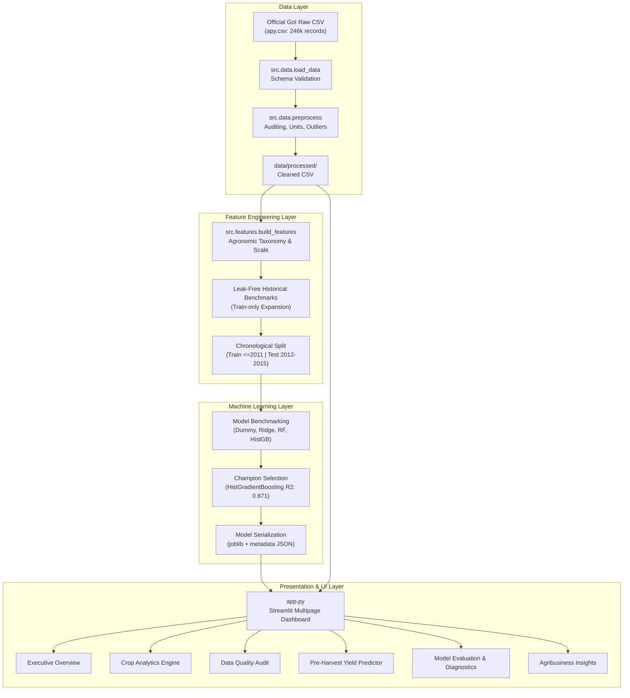

# AgriYield AI — System Architecture Specification

## 1. Architectural Overview

AgriYield AI is engineered using a modular, decoupled data science and software architecture that separates data ingestion, schema validation, feature engineering, machine learning pipelines, and interactive visualization.

---

## 2. Component Design & Modularity

### 2.1 Ingestion & Preprocessing Subsystem (`src/data/`)
- `load_data.py`:
  - Enforces canonical schema (`EXPECTED_COLUMNS`).
  - Implements resilient automated retrieval from primary Government endpoints with verifiable fallback mirror.
  - Generates actionable error messages on missing files or corrupt headers.
- `preprocess.py`:
  - Executes strip cleaning and casing normalization.
  - Implements documented missing value filtering for `Production`.
  - Flags non-tonne crops (`Unit_Type = "Thousand Nuts"` for Coconut).
  - Flags biological yield outliers based on Indian Council of Agricultural Research (ICAR) physiological thresholds.

### 2.2 Feature Engineering Subsystem (`src/features/`)
- `build_features.py`:
  - Implements taxonomic mapping from 124 agricultural commodities into 7 agronomic families (Cereals, Pulses, Oilseeds, Commercial, Horticulture, Plantation, Other).
  - Calculates operational farm landholding tiers (Marginal, Small, Semi-Medium, Medium, Large) adhering to Ministry of Agriculture brackets.
  - Computes $\text{Log\_Area} = \ln(\text{Area} + 1)$ to stabilize variance across farm scales.
  - Computes leak-free historical state-crop average yields strictly from training years $\le t-1$.

### 2.3 Model Training & Inference Subsystem (`src/models/`)
- `train.py`:
  - Manages the training lifecycle for candidate algorithms.
  - Utilizes `sklearn.compose.ColumnTransformer` for feature scaling and ordinal encoding.
  - Serializes champion pipeline (`models/best_yield_model.joblib`) and metadata (`models/model_metadata.json`).
- `evaluate.py`:
  - Computes comprehensive out-of-time evaluation metrics: MAE, RMSE, $R^2$, and MAPE.
  - Generates error breakdowns across major crops and agricultural seasons.
  - Computes residual diagnostics (mean, median, 10th/90th percentile errors).
- `predict.py`:
  - Validates user input parameters against physical and administrative boundaries.
  - Formats pre-harvest inputs into model feature matrix.
  - Generates yield forecast, expected gross harvest production, confidence intervals, and agribusiness advisory notices.

### 2.4 Presentation Subsystem (`app.py`, `src/visualization/`)
- `charts.py`:
  - Interactive Plotly chart builders utilizing a modern agricultural intelligence theme (`#1E3A2B`, `#2D5A3F`, `#D4A373`, `#8FBC8F`, `#F8FAF8`).
- `app.py`:
  - Multipage Streamlit application featuring persistent caching (`@st.cache_data`, `@st.cache_resource`), scoped custom CSS, and responsive layout cards.
